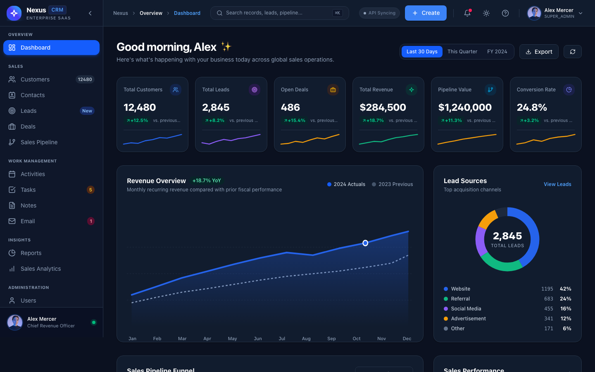
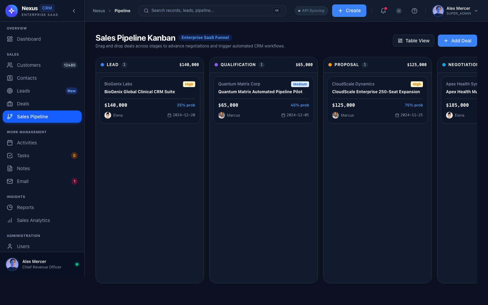
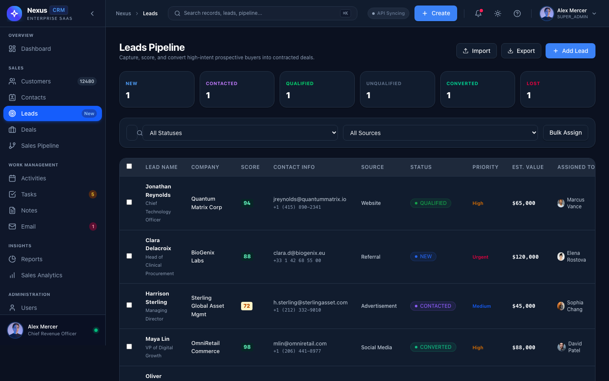
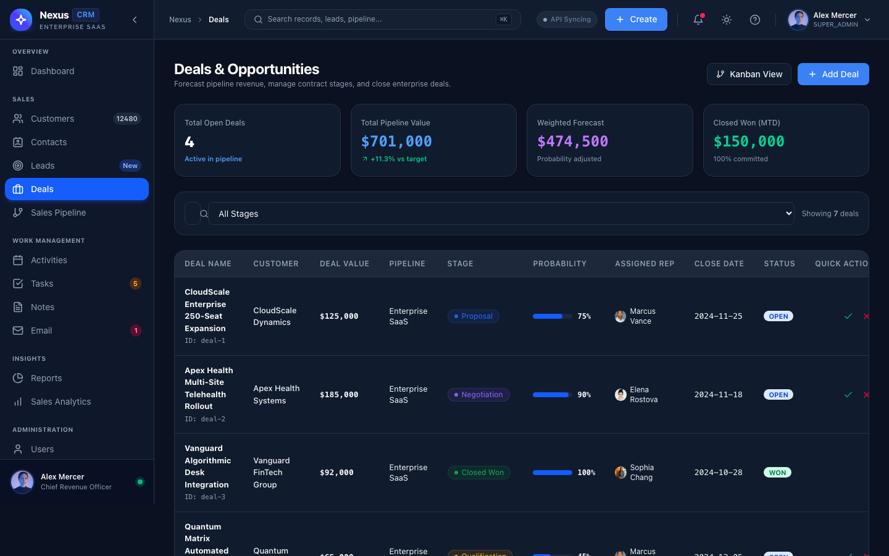
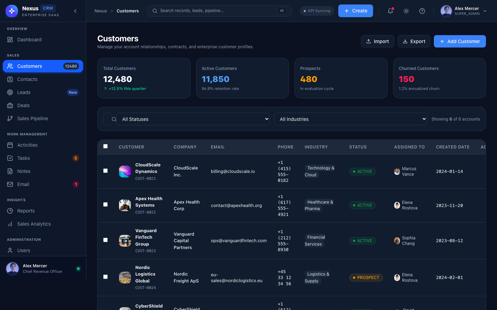
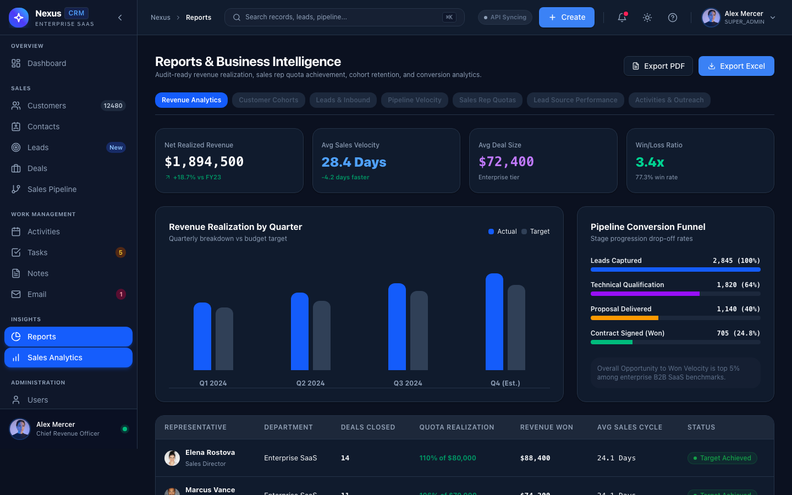
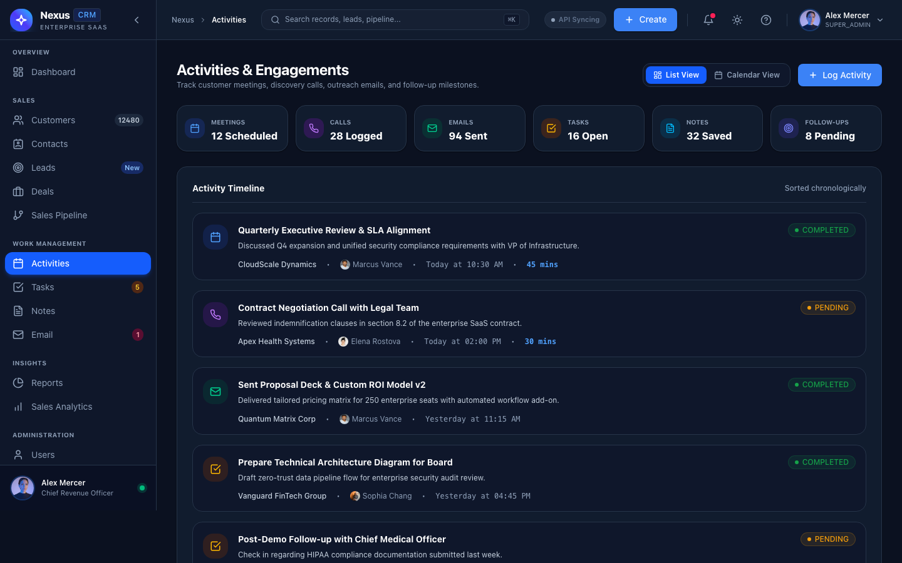
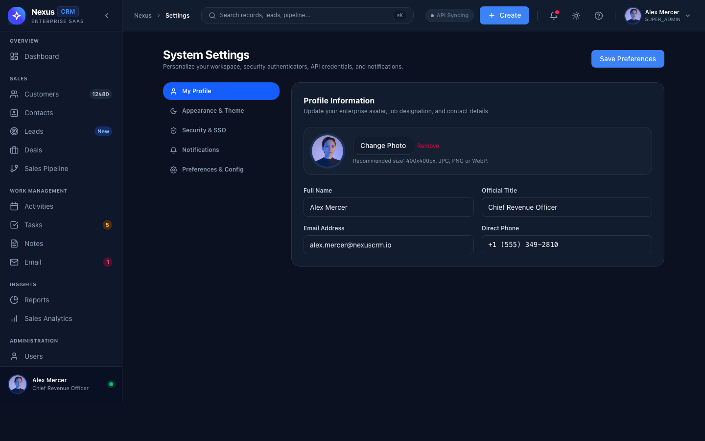
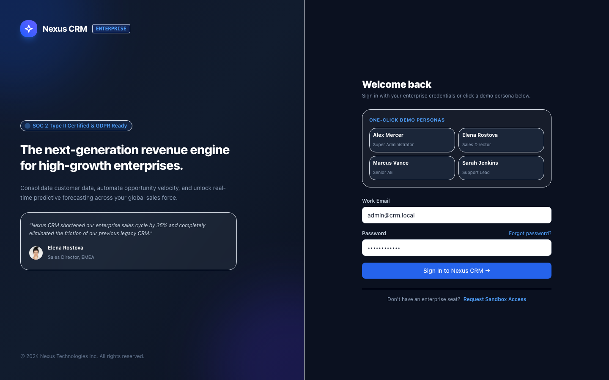
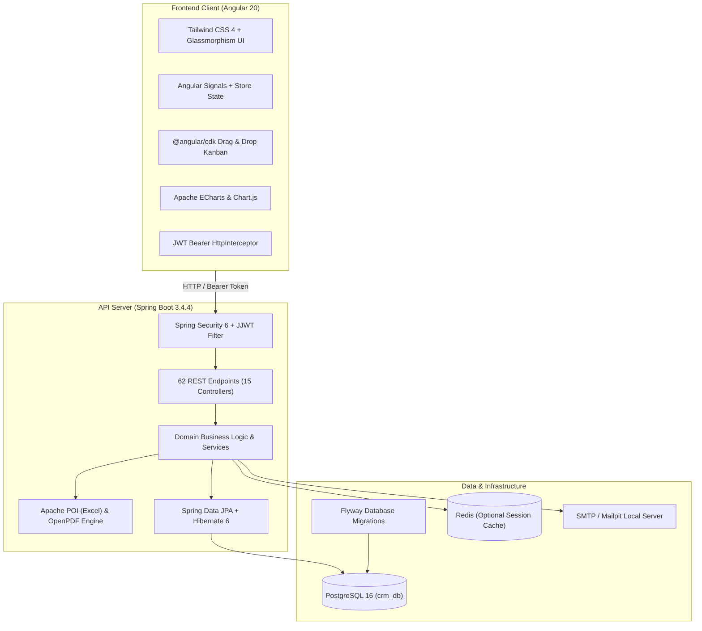

# Nexus CRM — Enterprise Customer Relationship Management Platform

[](https://angular.dev/)
[](https://spring.io/projects/spring-boot)
[](https://www.oracle.com/java/)
[](https://www.typescriptlang.org/)
[](https://tailwindcss.com/)
[](https://www.postgresql.org/)
[](https://www.docker.com/)
[](#license)

An enterprise-grade, high-velocity customer relationship management suite decoupling a high-performance **Angular 20 Single Page Application (SPA)** with Signal reactivity and Tailwind CSS from a modular, secure **Spring Boot 3.4 RESTful API** powered by **PostgreSQL 16**.

---

## 📸 UI Showcase Gallery

### 1. Executive Analytics & Revenue Dashboard
Real-time KPI metrics, revenue progression curves (2024 Actuals vs. 2023 Previous), lead acquisition source breakdown, and pipeline conversion metrics.


---

### 2. Interactive Drag & Drop Sales Kanban Pipeline
Visual pipeline stages (Lead, Qualification, Proposal, Negotiation) with dynamic deal stage progression using Angular CDK Drag and Drop.


---

### 3. Inbound Leads Management & Qualification
Complete lead lifecycle tracking, contact details, status tagging, deal values, and quick-action modals.


---

### 4. Deal Catalog & Opportunity Forecasting
Comprehensive opportunity records with win probability scoring, assigned sales reps, target closing dates, and status filters.


---

### 5. 360° Customer & Account Directory
Centralized customer portfolio with account health indicators, contact associations, generated revenue, and activity histories.


---

### 6. Business Intelligence & Executive Reports
Quarterly revenue realization charts, multi-stage conversion funnels, quota realization tracking, and instant Excel / PDF export capabilities.


---

### 7. Activities, Communications & Tasks Timeline
Audit logs of client communications (calls, meetings, follow-ups), impending task deadlines, and team assignments.


---

### 8. System Governance, Security & RBAC Settings
Enterprise governance, security policies, role permissions matrix, audit trails, and platform configurations.


---

### 9. Modern SaaS Authentication & Persona Switching
Secure JWT authentication portal with one-click demo persona switching for seamless multi-role testing.


---

## 🏛️ System Architecture



---

## 🚀 Technology Stack

### Frontend (`crm-frontend`)
| Layer / Tool | Version | Description |
|---|---|---|
| **Framework** | Angular 20.3.0 | Modern standalone components, native signals, and control flow syntax (`@if`, `@for`) |
| **Language** | TypeScript 5.9.2 | Strict typing, DTO models, and enum contracts matching backend models |
| **Styling** | Tailwind CSS 4.3.3 | Utility-first CSS, dark glassmorphism theme, responsive design |
| **Drag & Drop** | `@angular/cdk` 20.2.14 | Touch-ready Kanban board columns with smooth reordering |
| **Data Viz** | Apache ECharts 6.1.0 & Chart.js | Revenue curve charts, lead source donuts, and funnel visualizations |
| **Icons** | Lucide Angular 1.55.0 | Clean, stroke-based SVG icons |
| **Date Utils** | `date-fns` 4.4.0 | Relative timestamps and pipeline duration formatting |

### Backend (`crm-backend`)
| Component | Version | Description |
|---|---|---|
| **Language** | Java 21 LTS | Virtual threads, record types, and strict type safety |
| **Framework** | Spring Boot 3.4.4 | Dependency injection, auto-configuration, lifecycle orchestration |
| **Security** | Spring Security 6 + JJWT 0.12.6 | Stateless HMAC-SHA384 tokens, BCrypt password hashing, OncePerRequestFilter |
| **RBAC** | Granular Authorities | 43 permissions mapped across 7 distinct organizational roles |
| **Persistence** | Spring Data JPA / Hibernate 6 | Relational entity mappings, dynamic specifications, HikariCP pool |
| **Database** | PostgreSQL 16 (`crm_db`) | ACID transactional compliance, UUID primary keys, cascade rules |
| **Migrations** | Flyway 10.x | Version-controlled automated schema migrations (`V1` to `V8`) |
| **Document Export** | Apache POI 5.4.0 & OpenPDF 2.0.3 | Native server-side `.xlsx` spreadsheet and `.pdf` executive report export |
| **API Docs** | SpringDoc OpenAPI 3.1 (2.8.5) | Interactive Swagger UI (`/swagger-ui.html`) |

---

## 📂 Repository Directory Layout

```
crm-application/
├── crm-frontend/                        # Angular 20 SPA
│   ├── src/
│   │   ├── app/
│   │   │   ├── core/                   # Auth, Guards, Interceptors, Base Services
│   │   │   ├── features/               # Dashboard, Leads, Pipeline, Deals, Reports...
│   │   │   ├── layout/                 # Sidebar, Topbar, Main Shell
│   │   │   └── shared/                 # Modals, Reusable Buttons, Search Inputs
│   │   ├── environments/               # Dev and Prod API environment configs
│   │   └── styles.scss                 # Global Tailwind & Custom Styles
│   ├── angular.json
│   ├── package.json
│   └── tsconfig.json
│
├── crm-backend/                         # Spring Boot 3.4.4 API Server
│   ├── src/
│   │   ├── main/java/com/example/crm/
│   │   │   ├── config/                 # Security, CORS, Swagger configs
│   │   │   ├── controller/             # 15 REST Controllers
│   │   │   ├── dto/                    # Request & Response payload records
│   │   │   ├── entity/                 # JPA Relational Entities
│   │   │   ├── repository/             # Spring Data JPA Repositories
│   │   │   ├── security/               # JWT Token Provider, Auth Filters
│   │   │   └── service/                # Business logic, Excel & PDF generators
│   │   └── main/resources/
│   │       ├── db/migration/           # Flyway SQL migrations (V1 - V8)
│   │       └── application.yml         # Application configuration profiles
│   ├── pom.xml
│   ├── Dockerfile
│   └── docker-compose.yml
│
├── docs/
│   └── screenshots/                    # High-resolution frontend UI captures
│       ├── 01_dashboard.png
│       ├── 02_leads.png
│       ├── 03_pipeline_kanban.png
│       ├── 04_deals.png
│       ├── 05_customers.png
│       ├── 06_reports.png
│       ├── 07_activities.png
│       ├── 08_settings.png
│       └── 09_login.png
│
├── NEXUS_CRM_TECH_STACK_AND_ARCHITECTURE.pdf # Full Enterprise Architectural Spec
├── crm-application.code-workspace       # Multi-root IDE workspace definition
├── .gitignore                           # Unified monorepo ignore rules
└── README.md                            # Main project documentation
```

---

## ⚡ Quick Start Guide

### 1. Prerequisites
- **Node.js**: v20+ & npm 10+
- **Java**: OpenJDK 21 LTS
- **Maven**: 3.9+
- **Docker & Docker Compose** (Optional, for running PostgreSQL, Redis, Mailpit)

---

### 2. Running Backend (`crm-backend`)

#### Option A: Running with Docker Compose (Database + Services)
```bash
cd crm-backend
docker compose up -d
```
This launches PostgreSQL 16 on port `5432`, Mailpit on `1025`/`8025`, and Redis on `6379`.

#### Option B: Running Spring Boot locally
```bash
cd crm-backend
./mvnw spring-boot:run
# Or standard maven:
mvn spring-boot:run
```
The backend API initializes on **`http://localhost:8080`**.
- **Interactive Swagger UI**: [http://localhost:8080/swagger-ui.html](http://localhost:8080/swagger-ui.html)
- **OpenAPI JSON**: [http://localhost:8080/v3/api-docs](http://localhost:8080/v3/api-docs)

---

### 3. Running Frontend (`crm-frontend`)

```bash
cd crm-frontend

# Install dependencies (if not already installed)
npm install

# Start Angular development server
npm start
# or: ng serve
```
Navigate your browser to **`http://localhost:4200`**.

> **Note:** The frontend features resilient mock/demo fallback data so every screen, chart, and Kanban board renders completely even before connecting to a live database.

---

## 🔐 Default Credentials (Local Dev / Seed Data)

| Role | Email | Password | Scope |
|---|---|---|---|
| **Super Administrator** | `admin@crm.local` | `Password123!` | All 43 granular permissions & full system governance |
| **Sales Director** | `elena@crm.local` | `Password123!` | Sales pipeline, team quotas, and revenue reporting |
| **Senior AE** | `marcus@crm.local` | `Password123!` | Opportunities, customers, and deal closing |
| **Support Lead** | `sarah@crm.local` | `Password123!` | Contacts, tickets, tasks, and client communications |

---

## 📄 License
Internal Proprietary — All rights reserved. Nexus CRM Architecture Team.
